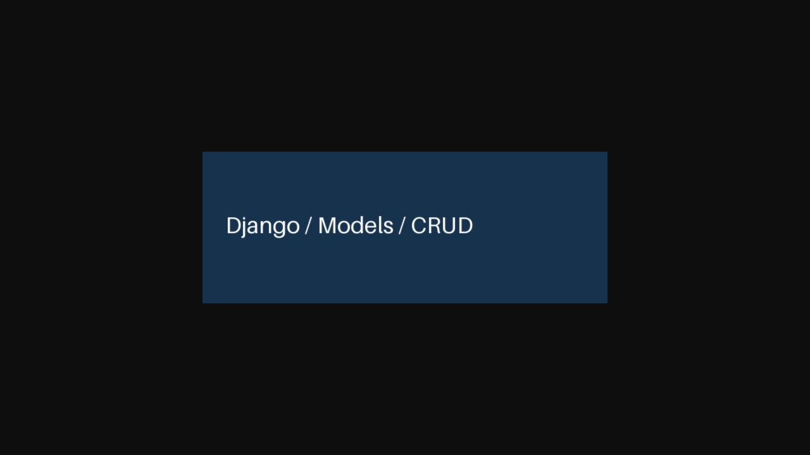

# Отчет по лабораторной работе № 2

МИНИСТЕРСТВО НАУКИ И ВЫСШЕГО ОБРАЗОВАНИЯ<br>
РОССИЙСКОЙ ФЕДЕРАЦИИ<br>
Федеральное государственное автономное<br>
образовательное учреждение высшего образования<br>
«СЕВЕРО-КАВКАЗСКИЙ ФЕДЕРАЛЬНЫЙ УНИВЕРСИТЕТ»<br>
Институт информационных технологий и кибер безопасности<br>
Департамент цифровых, робототехнических систем и электроники<br>
Кафедра программной инженерии

**Дисциплина:** Разработка веб-приложений

**Тема:** Модели. CRUD.

**Вариант:** 3 - Комментарии, без деления на уровни сложности

**Выполнил:**
Студент группы ПИЖ-б-о-25-2 (2),<br>
направление подготовки: 09.03.04<br>
“Программная инженерия”<br>

Кравцун Михаил Алексеевич

**Проверил:**
Заведующая МИБК<br>
Новикова Елена Николаевна

---

## Репозиторий

[web-app-development, лабораторная 2](https://github.com/WhXteBeXr/web-app-development/tree/main/lab2)

## Цель работы

Разработать модели Django, освоить миграции и работу с базой данных через ORM, выполнить создание, чтение, обновление и удаление записей.

## Постановка задачи

Общее задание выполняется на основе проекта лабораторной 1. Практическая часть включает модель `News`, настройку изображений, миграции и операции ORM.

Для варианта 3 требуется создать модель `Comment` с полями `user_name`, `email`, `text`, `created_at`, `is_moderated`, добавить целочисленный рейтинг `rating` от 1 до 5 и вывести комментарии, прошедшие модерацию. Деления на уровни сложности в методичке нет.

Нужно продемонстрировать CRUD через Django shell, методы `all()`, `filter()`, `exclude()`, `get()` и ответить на контрольные вопросы.

## Теоретическая часть

Модель наследует `models.Model` и описывает таблицу базы данных. Атрибуты классов полей задают типы столбцов, ограничения и поведение при сохранении. Первичный ключ `id` создается автоматически, обращение через `pk` не зависит от его имени.

Миграции хранят последовательность изменений схемы. `makemigrations` создает файлы, `sqlmigrate` показывает SQL, а `migrate` применяет изменения к базе. Состояние миграций отслеживается отдельно от исходников моделей.

ORM сопоставляет Python-объекты строкам таблицы. Конструктор модели еще не сохраняет запись. `save()` выполняет вставку или обновление, `objects.create()` сразу создает строку, `delete()` удаляет ее. `QuerySet` представляет запрос, который обычно выполняется при вычислении результата. `get()` возвращает один объект либо возбуждает исключение.

`blank` управляет допустимостью пустого значения при валидации, `null` - хранением SQL NULL. Метод `full_clean()` проверяет поля и ограничения, но обычный `save()` не вызывает его автоматически. Для защиты рейтинга независимо от валидации используется также ограничение CHECK базы данных.

## Исходные файлы и реализация

[news/models.py](../Project/news/models.py) содержит модели `News` и `Comment`. [Миграция 0001](../Project/news/migrations/0001_initial.py) создает обе таблицы, [миграция 0002](../Project/news/migrations/0002_comment_rating_comment_comment_rating_1_to_5.py) добавляет рейтинг и ограничение диапазона.

[config/settings.py](../Project/config/settings.py) настраивает SQLite и загружаемые изображения. [config/urls.py](../Project/config/urls.py) подключает маршруты приложения и раздачу медиафайлов в отладочном режиме. Контроллеры и страницы сохранены из первой работы. [demo.py](demo.py) содержит последовательную демонстрацию для запуска через Django shell.

### Модель News

| Поле | Тип и параметры | Назначение |
| --- | --- | --- |
| id | BigAutoField, первичный ключ | Автоматический идентификатор |
| title | CharField, max_length=150 | Заголовок |
| content | TextField, blank=True | Необязательный текст |
| created_at | DateTimeField, auto_now_add=True | Время создания |
| updated_at | DateTimeField, auto_now=True | Время последнего save() |
| photo | ImageField, blank=True | Путь к изображению |
| is_published | BooleanField, default=True | Признак публикации |

Фотография необязательна, чтобы поддержать показанные в методичке сценарии создания новости без файла. Метод `__str__()` возвращает заголовок.

### Модель Comment

| Поле | Тип и параметры | Назначение |
| --- | --- | --- |
| id | BigAutoField, первичный ключ | Автоматический идентификатор |
| user_name | CharField, max_length=100 | Имя автора |
| email | EmailField | Адрес электронной почты |
| text | TextField | Текст комментария |
| created_at | DateTimeField, auto_now_add=True | Время создания |
| is_moderated | BooleanField, default=False | Признак прохождения модерации |
| rating | PositiveSmallIntegerField, default=3 | Оценка от 1 до 5 |

Для рейтинга заданы `MinValueValidator(1)`, `MaxValueValidator(5)` и CHECK `comment_rating_1_to_5`. Значение по умолчанию 3 находится в допустимом диапазоне и используется также при добавлении поля к существующим строкам. Email не объявлен уникальным, один автор может оставлять несколько комментариев. Связь с новостью в задании не требуется.

## Практическая и индивидуальная части

Общий проект находится в `Project/`, база данных хранится в `Project/db.sqlite3`. Установлена Pillow 13.0.0, необходимая для `ImageField`. В `MEDIA_ROOT` указан каталог `Project/uploads`, в `MEDIA_URL` - префикс `/media/`. Материалы отчета хранятся отдельно в `lab2/media/`.

Применены стандартные миграции Django и две миграции приложения. Добавление рейтинга проверено на существующем комментарии: после второй миграции запись сохранилась и получила рейтинг 3. SQL создания таблиц и изменения схемы сохранен в [0001.sql](media/0001.sql) и [0002.sql](media/0002.sql).

Через `manage.py shell` выполнена демонстрация трех способов создания комментария: конструктор с последующим `save()`, присваивание полей пустому объекту и `objects.create()`. Проверены чтение, модерация, изменение текста и рейтинга, удаление и повторное чтение состояния базы.

Временные CRUD-примеры выполняются внутри транзакции с откатом. После них сохраняются три учебных комментария и новость с PNG-изображением. Повторный запуск демонстрации не дублирует эти записи.

### Учебные данные

| Автор | Рейтинг | Прошел модерацию |
| --- | --- | --- |
| Анна | 5 | Да |
| Борис | 1 | Да |
| Вера | 3 | Нет |

Для индивидуального задания выполнен запрос `Comment.objects.filter(is_moderated=True)`. В учебной базе он возвращает Анну и Бориса. Вера остается в выборке `exclude(is_moderated=True)`.

## Запуск

Команды выполнять из корня репозитория:

```bash
source .venv/bin/activate
python -m pip install -r requirements-dev.txt
python Project/manage.py migrate
python Project/manage.py shell < lab2/demo.py
python Project/manage.py check
python Project/manage.py runserver 127.0.0.1:8002
```

Самостоятельные запросы выполняются командой `python Project/manage.py shell`. Для просмотра SQL использовать `python Project/manage.py sqlmigrate news 0001` и аналогично `0002`. Базу можно открыть любым SQLite-менеджером по пути `Project/db.sqlite3`.

## Маршруты и ответы

CRUD выполняется через ORM в shell. Новые HTTP-эндпоинты для изменения комментариев в задании не предусмотрены.

| Запрос | Ответ |
| --- | --- |
| GET `/news/` | 200, `Hello world` |
| GET `/news/test/` | 200, `<h1>Тестовая страница</h1>` |
| HEAD для обеих страниц | 200 без тела |
| GET адреса страниц без завершающего слеша | 301 на путь со слешем |
| GET `/admin/` без входа | 302 на форму авторизации |
| POST без CSRF-токена | 403 |
| POST с корректным токеном на обе страницы | 405, разрешены GET и HEAD |
| GET `/media/photos/2026/11/18/django-models.png` | 200, PNG 640 на 240 пикселей |
| GET отсутствующего изображения | 404 |
| GET `/media/../config/settings.py` | 400, попытка выйти за каталог отклонена |

Адрес изображения формируется из даты его создания, актуальное значение доступно в `photo.url`.

## Результаты выполнения и проверки

Проверка выполнена 18 ноября 2026 года. Python 3.14.10, Django 6.1.1, Pillow 13.0.0.

| Сценарий | Ожидаемый результат | Фактический результат |
| --- | --- | --- |
| Конструктор без save() | pk отсутствует | Совпадает |
| Три способа создания | Три строки с назначенными pk | Совпадает |
| Рейтинг 1 и 5 | Допустимые границы сохраняются | Совпадает |
| all(), get(), filter(), exclude() | Возвращаются ожидаемые записи | Совпадает |
| Ленивый QuerySet | 0 SQL до вычисления, 1 после, повторный list() использует кеш | Совпадает |
| Изменение и save() | Новые поля читаются из базы, created_at сохранено | Совпадает |
| Удаление | Запись отсутствует после delete() | Совпадает |
| Рейтинг 0, 6 и None | ValidationError | Совпадает |
| Неверный email, пустые имя и текст, длинное имя | ValidationError | Совпадает |
| update(rating=0) и update(rating=6) | IntegrityError, исходные строки не испорчены | Совпадает |
| get() отсутствующей и неоднозначной записи | DoesNotExist и MultipleObjectsReturned | Совпадает |
| CRUD News и auto_now | Все операции выполнены, updated_at обновлено | Совпадает |
| Повторная демонстрация на новой базе | 3 комментария, 1 новость, 1 изображение | Совпадает после двух запусков |
| Раздача изображения | Файл совпадает с сохраненным PNG, размер 640 на 240 | Совпадает |
| HTTP-сценарии страниц, ошибок и файлов | Ожидаемые статусы и тела | Пройдены все 19 |

Подробный вывод: [ORM](media/orm-demo.txt), [19 HTTP-сценариев](media/http-scenarios.json), [воссоздание базы и повторный запуск](media/rebuild-check.txt), [окружение и системные проверки](media/environment.txt).



Рисунок 1 - файл, сохраненный через `News.photo` и полученный по адресу `/media/`.

## Контрольные вопросы

### 1. Что такое модель в Django и для чего она используется?

Это класс-наследник `models.Model`, описывающий структуру и поведение данных. Обычно экземпляр соответствует строке, класс - таблице, поля - ее столбцам.

### 2. Какие типы полей вы знаете?

`CharField` для ограниченной строки, `TextField` для текста, `EmailField` для адреса почты, `DateTimeField` для даты и времени, `BooleanField` для признака, целочисленные поля для количества или рейтинга, `ImageField` для пути к изображению. Связи задаются специальными полями отношений.

### 3. Чем отличаются blank=True и null=True?

`blank=True` разрешает пустое значение при валидации модели и формы, `null=True` разрешает SQL NULL в базе. Для необязательных строк обычно используется пустая строка и `blank=True` без `null=True`.

### 4. Что такое миграции и каковы основные команды?

Это версионируемые изменения схемы базы. `makemigrations` создает файлы, `migrate` применяет или откатывает их, `showmigrations` показывает состояние, `sqlmigrate` выводит SQL выбранной миграции.

### 5. Как создать суперпользователя?

Выполнить `python Project/manage.py createsuperuser` после миграций и интерактивно ввести учетные данные. Для этой работы создавать администратора не требуется, ORM доступен через shell.

### 6. Что такое ORM и методы CRUD?

ORM связывает объекты языка с реляционной базой. Создание: конструктор и `save()` либо `objects.create()`. Чтение: `all()`, `filter()`, `get()`, `exclude()`. Изменение: присваивание полей и `save()` либо `QuerySet.update()`. Удаление: `delete()` объекта или набора.

### 7. В чем разница между filter() и get()?

`filter()` возвращает QuerySet с любым количеством строк, включая ноль. `get()` требует ровно одну строку и иначе возбуждает `DoesNotExist` или `MultipleObjectsReturned`.

### 8. Как настроить изображения?

Установить Pillow, объявить `ImageField(upload_to=...)`, задать `MEDIA_ROOT` и `MEDIA_URL`, в режиме разработки подключить `static()` для медиа. В базе хранится путь, файл сохраняется через хранилище. Для проверки загружаемого пользователем файла нужна также валидация формы, само поле модели при прямом save() не заменяет ее.

### 9. Для чего нужен __str__?

Для понятного строкового представления объекта в shell, формах и административной панели. У `News` это заголовок, у `Comment` - автор и начало текста.

### 10. Что будет после makemigrations без migrate?

Файл описания изменения появится, но схема базы не изменится. Обращение к новой таблице или полю может вызвать ошибку базы. Нужно применить миграцию через `migrate`.

## Вывод

Созданы модели практической части и варианта 3, выполнены миграции, настроено хранение изображений. Работа CRUD, фильтрации, валидации и ограничений рейтинга подтверждена запуском через Django shell. Получена выборка модерированных комментариев. Проверены повторное наполнение новой базы, 19 HTTP-сценариев и получение изображения в браузере.
