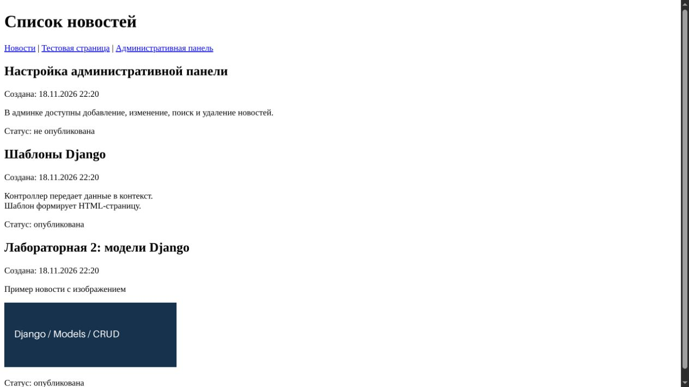
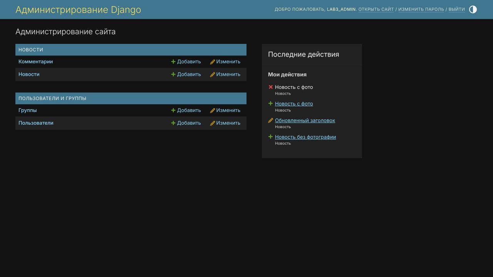
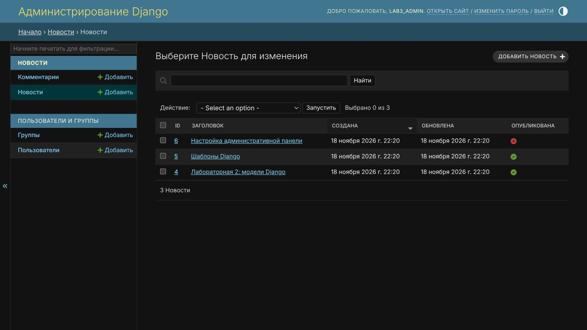
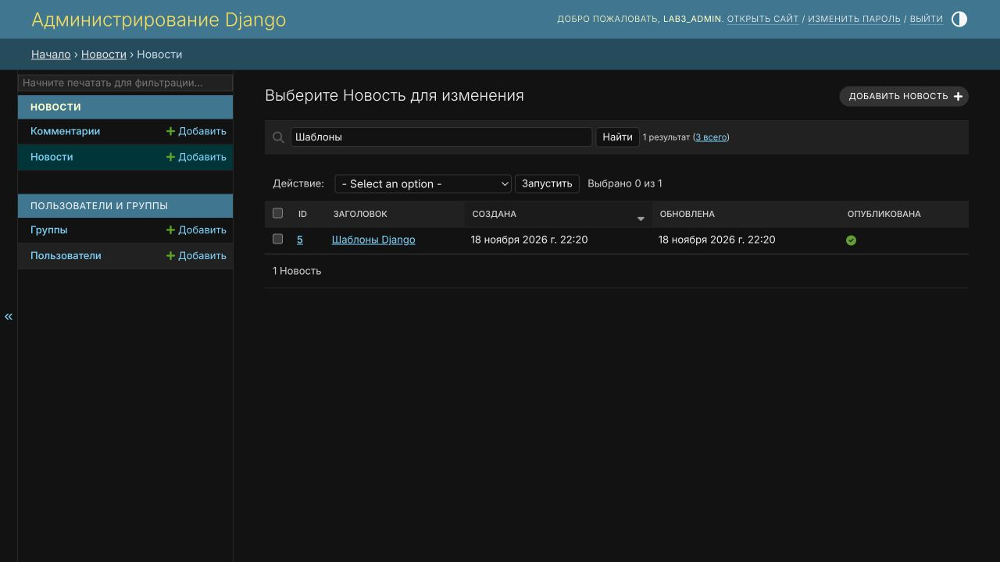
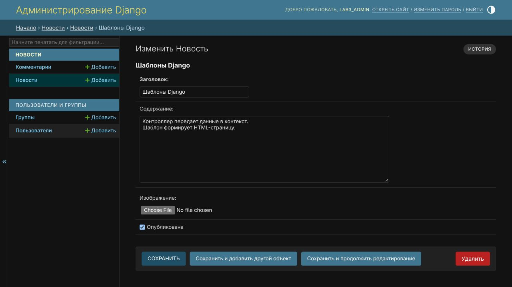

# Отчет по лабораторной работе № 3

МИНИСТЕРСТВО НАУКИ И ВЫСШЕГО ОБРАЗОВАНИЯ<br>
РОССИЙСКОЙ ФЕДЕРАЦИИ<br>
Федеральное государственное автономное<br>
образовательное учреждение высшего образования<br>
«СЕВЕРО-КАВКАЗСКИЙ ФЕДЕРАЛЬНЫЙ УНИВЕРСИТЕТ»<br>
Институт информационных технологий и кибер безопасности<br>
Департамент цифровых, робототехнических систем и электроники<br>
Кафедра программной инженерии

**Дисциплина:** Разработка веб-приложений

**Тема:** Шаблоны. Админка Django

**Вариант:** Не предусмотрен методичкой, выполняется вся практическая часть

**Выполнил:**
Студент группы ПИЖ-б-о-25-2 (2),<br>
направление подготовки: 09.03.04<br>
“Программная инженерия”<br>

Кравцун Михаил Алексеевич

**Проверил:**
Заведующая МИБК<br>
Новикова Елена Николаевна

---

## Репозиторий

[web-app-development](https://github.com/WhXteBeXr/web-app-development), общий код в каталоге `Project/`.

## Цель работы

Освоить вывод данных модели через HTML-шаблон Django и управление записями через административную панель. Настроить контекст, сортировку, локализацию, список полей, поиск и формы редактирования.

## Постановка задачи

Методичка не содержит индивидуальных вариантов, уровней сложности и контрольных вопросов. Выполнена вся описанная практическая часть:

1. Получить новости из модели и передать их в шаблон через контекст.
2. Создать HTML-шаблон в пространстве имен приложения `templates/news/`.
3. Вывести заголовки, содержание и даты, использовать цикл и фильтр форматирования.
4. Задать порядок новостей через `Meta.ordering`.
5. Создать суперпользователя для проверки административной панели.
6. Зарегистрировать модель и настроить русские названия приложения, моделей и полей.
7. Настроить колонки списка, ссылки редактирования и поиск.
8. Проверить добавление, изменение и удаление записей, загрузку фотографии и сохранение без нее.

## Теоретическая часть

В Django слой представления получает данные и передает их шаблону. Контекст - словарь с именованными значениями. Функция `render(request, template_name, context)` загружает шаблон, подставляет значения и формирует HTTP-ответ. При `APP_DIRS=True` шаблоны ищутся в каталогах установленных приложений. Путь `news/index.html` позволяет различать одноименные шаблоны разных приложений.

Конструкция `{{ variable }}` выводит значение, `` обходит набор данных, `` выбирает ветку. Ветка `` обрабатывает пустую выборку. Фильтр `date` задает формат даты, `linebreaksbr` сохраняет переносы текста. Автоматическое экранирование не дает введенным HTML-тегам превратиться в исполняемую разметку.

Административная панель строит формы и списки на основании моделей. Класс `ModelAdmin` задает их настройки. Доступ требует активного пользователя с признаком `is_staff` и соответствующими правами. Суперпользователь имеет все разрешения. Формы админки проверяют обязательные поля и изображения, изменяющие запросы защищены CSRF.

## Исходные файлы и реализация

[news/views.py](../Project/news/views.py) получает `News.objects.all()` и передает `news` и `title` в [news/index.html](../Project/news/templates/news/index.html). HTML не собирается строками в Python. Проверочная страница `/news/test/` сохранена.

[news/models.py](../Project/news/models.py) задает русские названия и порядок `-created_at`, затем `-pk` для одинаковых дат. [news/apps.py](../Project/news/apps.py) задает русское имя приложения. [Миграция 0003](../Project/news/migrations/0003_alter_comment_options_alter_news_options.py) сохраняет изменения метаданных обеих моделей.

[news/admin.py](../Project/news/admin.py) регистрирует новости и комментарии. В `NewsAdmin` колонки: идентификатор, заголовок, даты создания и обновления, признак публикации. Ссылками редактирования являются идентификатор и заголовок. Поиск работает по заголовку и содержанию. `CommentAdmin` предоставляет доступ к модели варианта 3 второй работы, включая проверку рейтинга. Ссылка «Открыть сайт» ведет на ленту `/news/`.

[demo.py](demo.py) добавляет две учебные новости без дублирования при повторном запуске. Исходники сайта остаются в единственном общем проекте, папка лабораторной содержит только материалы и сценарий демонстрации.

## Практическая часть

### Шаблон и контекст

Создан стандартный HTML-документ с `lang="ru"`, кодировкой UTF-8, заголовком страницы и навигацией. Заголовок берется из контекста `title`, записи из `news` выводятся циклом. У новости отображаются заголовок, дата, содержание, необязательное изображение и статус публикации. Если записей нет, показывается сообщение «Новостей пока нет».

Дата отображается как `18.11.2026 22:20`, машинное значение находится в атрибуте `datetime` тега `time`. Изображение выводится только при наличии файла. Заголовки, содержание и атрибуты экранируются шаблонизатором.

Как в методичке с `all()`, учебная лента показывает все новости, включая неопубликованные. Статус каждой записи явно подписан. Фильтрация по признаку публикации в этой работе не вводится.

### Сортировка и локализация

Сортировка по умолчанию находится в модели. Новые новости отображаются первыми, при равной дате записи идут по убыванию первичного ключа. Этот порядок применяется к обычной выборке и списку админки.

Язык `ru-ru` и часовой пояс `Europe/Moscow` настроены в проекте. `verbose_name` и `verbose_name_plural` задают названия «Новость», «Новости», «Комментарий», «Комментарии». Поля моделей имеют русские подписи.

### Административная панель

С помощью суперпользователя проверены вход, создание новости без фотографии, изменение заголовка и текста, поиск, добавление корректного PNG и удаление с подтверждением. Проверены ошибки пустого заголовка и неверного изображения. Журнал действий содержит операции создания, изменения и удаления.

Фотография остается необязательной благодаря `blank=True`, заданному во второй работе. Комментарии доступны через отдельный список админки, прежние ограничения рейтинга сохранены.

## Запуск

Из корня репозитория:

```bash
source .venv/bin/activate
python Project/manage.py migrate
python Project/manage.py shell < lab2/demo.py
python Project/manage.py shell < lab3/demo.py
python Project/manage.py createsuperuser
python Project/manage.py runserver 127.0.0.1:8002
```

Если суперпользователь уже существует, повторно создавать его не нужно. Имя и пароль выбираются при выполнении `createsuperuser`. Тестовая учетная запись использовалась только в отдельной временной базе проверки и не добавлялась в рабочую базу.

Открыть `http://127.0.0.1:8002/news/`, затем `/admin/` и войти. В списке новостей добавить запись, найти ее по заголовку или содержанию, изменить и проверить ленту. Для удаления подтвердить действие в стандартной форме. В браузерной проверке использовался локальный порт 8013.

## Маршруты и ответы

| Запрос | Результат |
| --- | --- |
| GET `/news/` | 200, HTML-страница списка новостей |
| GET `/news/test/` | 200, тестовый HTML-заголовок |
| HEAD `/news/` | 200, заголовки без тела |
| GET неизвестного пути | 404 |
| POST `/news/` с корректным CSRF-токеном | 405, разрешены GET и HEAD |
| GET `/admin/` без входа | 302 на форму входа |
| POST формы входа с верными данными | 302 в административную панель |
| POST формы входа с неверным паролем | 200, форма с ошибкой |
| GET `/admin/news/news/` | 200 для администратора, таблица новостей |
| GET `/admin/news/news/?q=...` | 200, результат поиска по заголовку и содержанию |
| GET `/admin/news/news/add/` | 200, форма создания |
| POST корректной формы добавления или изменения | 302 после сохранения |
| POST формы с ошибками | 200, ошибки полей, запись не создается |
| GET `/admin/news/news/<id>/delete/` | 200, подтверждение удаления |
| POST подтверждения удаления | 302, строка удалена |

Это HTML-интерфейс. Формы используют стандартные поля Django и CSRF-токен, JSON API в задании не предусмотрен.

## Результаты проверки

Проверено 18 ноября 2026 года, Python 3.14.10, Django 6.1.1. Сценарии форм и прав доступа выполнялись клиентом Django с включенной проверкой CSRF в отдельной временной базе. Затем сервер был запущен, в браузере проверены лента, вход, списки моделей, поиск и форма редактирования.

| Сценарий и ожидаемое поведение | Результат |
| --- | --- |
| 1. Пустая лента: 200 и сообщение | Подтверждено |
| 2. Шаблон news/index.html и контекст | Подтверждено |
| 3. Админка без входа требует авторизации | Подтверждено |
| 4. Неверный пароль отклонен | Подтверждено |
| 5. Вход суперпользователя через форму | Подтверждено |
| 6. Русские названия приложения и моделей | Подтверждено |
| 7. Открыть сайт ведет на ленту | Подтверждено |
| 8. Пустой заголовок не сохраняется | Подтверждено |
| 9. Добавление новости без фотографии | Подтверждено |
| 10. Изменение через админку сохранено | Подтверждено |
| 11. Новости по убыванию даты | Подтверждено |
| 12. Автоэкранирование текста | Подтверждено |
| 13. Статус неопубликованной записи показан | Подтверждено |
| 14. Даты отформатированы | Подтверждено |
| 15. Одинаковые даты: порядок по pk | Подтверждено |
| 16. Колонки и ссылки редактирования | Подтверждено |
| 17. Поиск по содержимому | Подтверждено |
| 18. Поиск по заголовку | Подтверждено |
| 19. Поиск без совпадений | Подтверждено |
| 20. Добавление PNG через админку | Подтверждено |
| 21. Шаблон выводит изображение | Подтверждено |
| 22. Изображение доступно по MEDIA_URL | Подтверждено |
| 23. Неверное изображение не сохраняется | Подтверждено |
| 24. Подтверждение удаления доступно | Подтверждено |
| 25. Удаление новости через админку | Подтверждено |
| 26. Журнал действий админа | Подтверждено |
| 27. Валидация рейтинга комментария в админке | Подтверждено |
| 28. Обычный пользователь не входит в админку | Подтверждено |
| 29. Тестовая страница прежней работы доступна | Подтверждено |
| 30. HEAD без тела | Подтверждено |
| 31. Неизвестный URL | Подтверждено |
| 32. POST с токеном запрещен для списка | Подтверждено |

Все 32 сценария пройдены. Отдельно повторно выполнена демонстрация ORM второй работы, она завершилась успешно. Системная проверка Django, проверка миграций и Ruff ошибок не обнаружили. Результаты: [scenarios.json](media/scenarios.json), [environment.txt](media/environment.txt).



Рисунок 1 - данные модели в HTML-шаблоне, даты, статусы и фотография.



Рисунок 2 - русские названия приложения и моделей, журнал действий.



Рисунок 3 - колонки и ссылки редактирования.



Рисунок 4 - одна найденная новость по запросу «Шаблоны».



Рисунок 5 - изменение новости без обязательной загрузки фотографии.

## Вывод

Реализован вывод новостей через шаблон с контекстом, форматированием дат и сортировкой модели. Настроены русские названия, административные списки, ссылки и поиск. Проверены управление новостями, изображения, ошибки форм и доступ пользователей. Возможности второй работы сохранены в общем Django-проекте.
