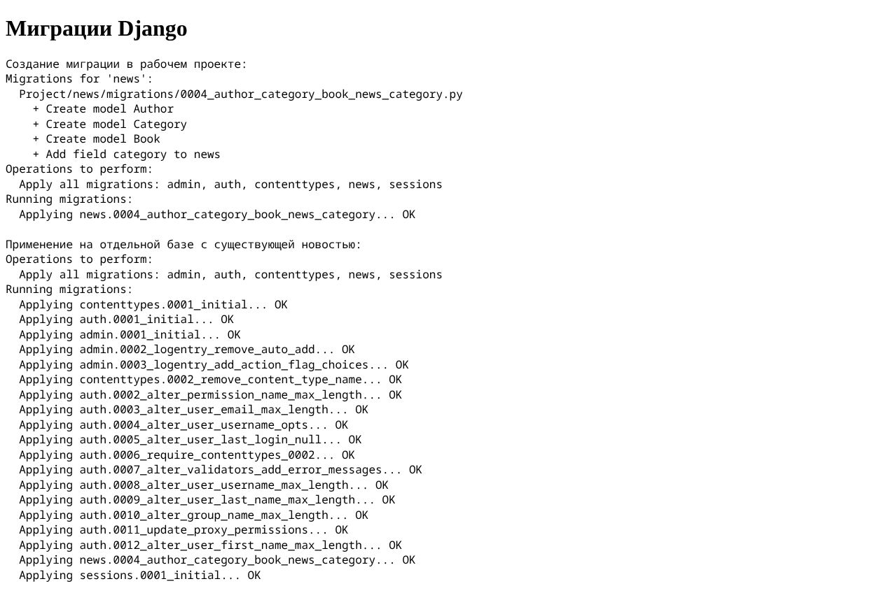
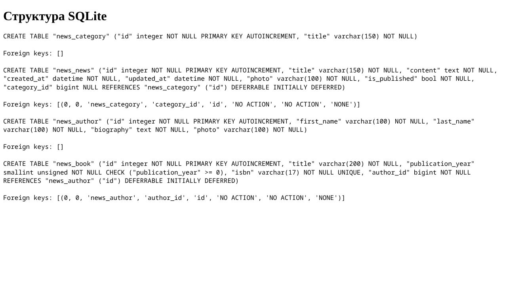
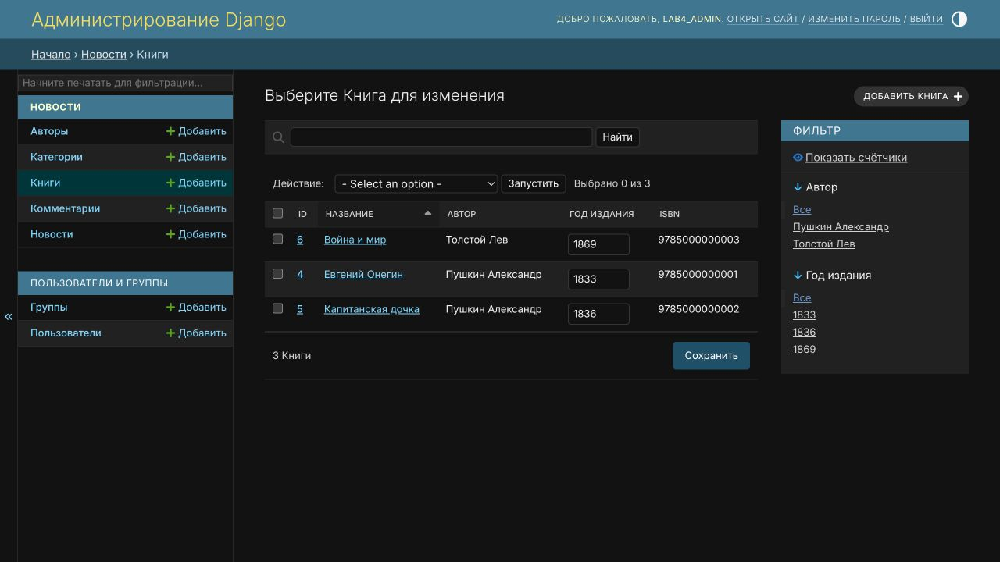
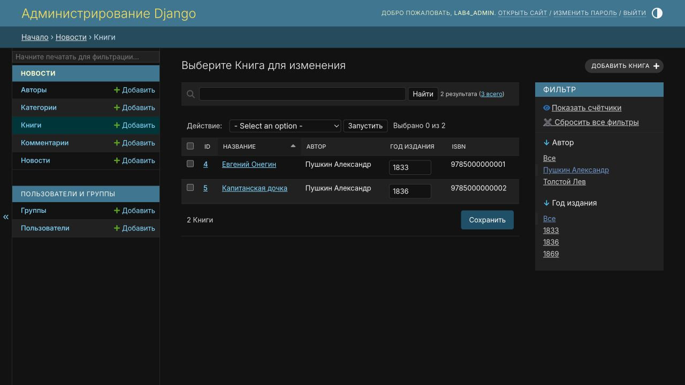
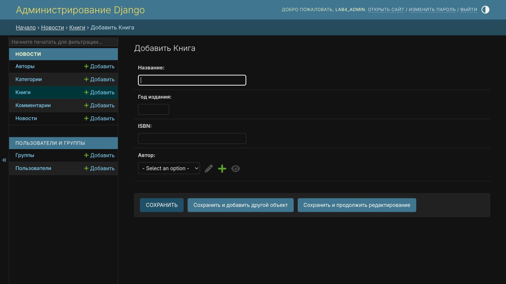
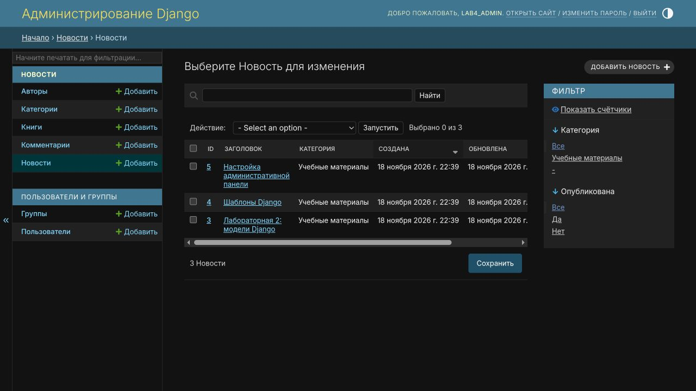

# Отчет по лабораторной работе № 4

МИНИСТЕРСТВО НАУКИ И ВЫСШЕГО ОБРАЗОВАНИЯ<br>
РОССИЙСКОЙ ФЕДЕРАЦИИ<br>
Федеральное государственное автономное<br>
образовательное учреждение высшего образования<br>
«СЕВЕРО-КАВКАЗСКИЙ ФЕДЕРАЛЬНЫЙ УНИВЕРСИТЕТ»<br>
Институт информационных технологий и кибер безопасности<br>
Департамент цифровых, робототехнических систем и электроники<br>
Кафедра программной инженерии

**Дисциплина:** Разработка веб-приложений

**Тема:** Связи моделей. Внешний вид шаблона

**Вариант:** 3 - Библиотека: книги и авторы, без деления на уровни сложности

**Выполнил:**
Студент группы ПИЖ-б-о-25-2 (2),<br>
направление подготовки: 09.03.04<br>
“Программная инженерия”<br>

Кравцун Михаил Алексеевич

**Проверил:**
Заведующая МИБК<br>
Новикова Елена Николаевна

---

## Репозиторий

[web-app-development, лабораторная 4](https://github.com/WhXteBeXr/web-app-development/tree/main/lab4)

## Цель работы

Освоить создание и настройку связей моделей Django, параметры `on_delete`, `related_name`, `null`, `blank` и `default`, применение миграций к существующим данным и отображение связанных объектов в административной панели.

## Постановка задачи

Общая практическая часть: создать категории новостей, связать их с `News`, применить миграцию, настроить связанные значения, фильтры и редактирование публикации в списке.

Индивидуальный вариант 3:

- `Author`: имя, фамилия, биография, фотография.
- `Book`: название, год издания, ISBN.
- Связь ForeignKey, один автор имеет много книг.
- `on_delete=CASCADE`, при удалении автора удаляются его книги.
- `related_name="books"`, обратный доступ через `author.books`.

Для связанных моделей настроить списки, фильтры, редактирование и поиск. Проверить создание, связывание и удаление через админку. В методичке нет уровней сложности и контрольных вопросов.

## Теоретическая часть

**ForeignKey** реализует отношение «многие к одному». Во вторичной таблице хранится идентификатор первичной записи. Внешний ключ обеспечивает ссылочную целостность. Django автоматически создает индекс для такого поля.

**ManyToManyField** реализует «многие ко многим» через промежуточную таблицу. Например, книгу с несколькими авторами можно было бы представить таким отношением, но в данном варианте прямо задан один автор у каждой книги.

**OneToOneField** реализует связь «один к одному» с уникальным внешним ключом, например отдельный профиль пользователя. Для выбранного варианта используется ForeignKey, остальные типы рассмотрены теоретически.

`on_delete` определяет поведение Django при удалении связанного объекта: CASCADE удаляет зависимые записи, PROTECT запрещает удаление, SET_NULL оставляет зависимые записи с NULL при допустимом `null=True`.

`related_name` задает имя обратного менеджера. `null` разрешает NULL на уровне базы, `blank` управляет обязательностью поля при проверке формы и модели. `default` задает значение по умолчанию. Для внешнего ключа произвольный `default=1` некорректен, если связанной строки с таким ключом нет.

## Исходные файлы и реализация

[news/models.py](../Project/news/models.py) содержит связанные модели и поясняющие комментарии к параметрам связей. [Миграция 0004](../Project/news/migrations/0004_author_category_book_news_category.py) создает Author, Book и Category, добавляет категорию к News. Полный код находится в этих файлах и не дублируется листингом в отчете.

[news/admin.py](../Project/news/admin.py) регистрирует модели, задает списки, фильтры, редактирование и поиск. [news/views.py](../Project/news/views.py) получает новости вместе с категориями, [index.html](../Project/news/templates/news/index.html) выводит категорию или подпись «Без категории». [demo.py](demo.py) подготавливает примеры и демонстрирует удаление связанных данных с откатом временных изменений.

### Модели варианта 3

| Модель | Поля | Особенности |
| --- | --- | --- |
| Author | first_name, last_name | Обязательные строки до 100 символов |
| Author | biography | Необязательный текст |
| Author | photo | Необязательное изображение в uploads/authors/ |
| Book | title | Обязательная строка до 200 символов |
| Book | publication_year | Целое число, валидация от 1 до 9999 |
| Book | isbn | Обязательная уникальная строка до 17 символов |
| Book | author | Обязательный ForeignKey на Author, CASCADE, related_name="books" |

Идентификаторы `id` создаются автоматически. Метод `Author.__str__()` возвращает фамилию и имя, `Book.__str__()` - название. Поле author не допускает NULL и пустого значения формы, значение по умолчанию не задается. Автор должен быть выбран явно.

### Категории новостей

`Category.title` - индексированная строка до 150 символов. `News.category` использует PROTECT и `related_name="news"`. Связь допускает `null=True` и `blank=True`: старые новости сохраняются, а прежние демонстрации без категории продолжают работать. В ленте отсутствие категории обозначается явно.

## Практическая и индивидуальная части

### Миграция и существующие данные

Создана и применена миграция 0004. Она добавляет новые таблицы и nullable-поле `category_id`, не назначая несуществующую категорию по умолчанию. Ранее примененные миграции не удаляются и не переписываются.

Переход проверен отдельно: в схеме до миграции 0004 создана новость, затем применены изменения. Та же запись сохранилась с прежним содержанием и NULL в категории. После этого связь с существующей категорией успешно установлена через админку.

### Административная панель

| Модель | Список и связи | Фильтры | Редактирование в списке | Поиск |
| --- | --- | --- | --- | --- |
| Book | id, название, автор, год, ISBN | Автор, год | Год издания | Название, ISBN, имя и фамилия автора |
| Author | id, фамилия, имя | Не требуется | Через форму | Имя, фамилия, биография |
| News | id, заголовок, категория, даты, публикация | Категория, публикация | Признак публикации | Заголовок, содержание |
| Category | id, название | Не требуется | Через форму | Название |

Идентификаторы и названия служат ссылками изменения. Редактируемые колонки не пересекаются с колонками-ссылками. Для списков с внешними ключами задан `list_select_related`, чтобы получение связанного имени не создавало запрос на каждую строку.

### Учебные данные и обратные связи

Созданы два автора и три книги. У Александра Пушкина в учебном наборе две книги, у Льва Толстого одна. ISBN примеров условные. Обратная выборка `pushkin.books.all()` возвращает только книги выбранного автора.

Категория «Учебные материалы» связана с демонстрационными новостями предыдущих работ. Сценарий назначает ее только известным учебным записям без категории и не заменяет ранее выбранные категории. Обратная выборка `category.news.all()` возвращает связанные новости.

### Удаление и целостность

При подтвержденном удалении первого тестового автора через админку удалились обе его книги. Второй автор и его книга сохранились. Форма подтверждения заранее показала зависимые объекты.

Категория с новостями защищена: ORM возбуждает ProtectedError, админка показывает препятствующие удалению записи. Повторный POST не обходит защиту. Пустая категория удаляется.

Проверка `PRAGMA foreign_key_check` не обнаружила нарушений. В SQLite определены внешние ключи `news_book.author_id` и `news_news.category_id`. Политики CASCADE и PROTECT выполняются механизмом удаления Django, а не SQL-параметром ON DELETE CASCADE в приведенной схеме. Для прямых SQL-операций действуют ограничения самой базы.

## Запуск

Из корня репозитория:

```bash
source .venv/bin/activate
python Project/manage.py migrate
python Project/manage.py shell < lab2/demo.py
python Project/manage.py shell < lab3/demo.py
python Project/manage.py shell < lab4/demo.py
python Project/manage.py runserver 127.0.0.1:8002
```

Для первого входа создать своего администратора командой `python Project/manage.py createsuperuser`. Если он уже существует, использовать его учетную запись.

Открыть `/admin/news/author/`, `/admin/news/book/`, `/admin/news/category/` и `/admin/news/news/`. Добавить отдельного пробного автора, связать с ним книги, проверить фильтр по автору и изменение года в списке. Удаление автора выполнять только для пробных записей, поскольку его книги действительно удаляются.

Демонстрационный `lab4/demo.py` проверяет CASCADE на временном авторе и книге внутри откатываемой транзакции. Постоянные примеры остаются в базе.

## Маршруты и ответы

| Запрос | Результат |
| --- | --- |
| GET `/admin/news/author/` | Список авторов для администратора |
| GET `/admin/news/book/` | Список книг, связанные авторы и фильтры |
| GET `/admin/news/book/?author__id__exact=<id>` | Книги выбранного автора |
| GET `/admin/news/book/?publication_year=<год>` | Книги выбранного года |
| GET `/admin/news/book/?q=<текст>` | Поиск по книге, ISBN и автору |
| POST корректной формы | 302 после сохранения |
| POST формы без автора, с повторным ISBN или неверным годом | 200, ошибки формы, новая строка не появляется |
| GET подтверждения удаления автора | 200, список зависимых книг |
| POST подтверждения удаления автора | 302, автор и его книги удалены |
| GET или POST удаления занятой категории | 200, сообщение о защите, данные сохраняются |
| GET `/news/` | 200, лента с категориями |

Используются стандартные HTML-формы Django Admin с CSRF-защитой. Отдельный JSON API не требуется.

## Результаты проверки

Проверка выполнена 18 ноября 2026 года, Python 3.14.10, Django 6.1.1. Выполнены 42 сценария, включая реальные POST стандартных форм админки с CSRF-токенами. Проверка проводилась на отдельной временной базе, рабочие учетные записи не изменялись.

| Сценарий и ожидаемое поведение | Фактический результат |
| --- | --- |
| 1. Миграция сохранила старую новость с NULL category | Подтверждено |
| 2. Без входа админка недоступна | Подтверждено |
| 3. Вход администратора | Подтверждено |
| 4. Автор создан через форму без фото | Подтверждено |
| 5. Второй автор создан через форму | Подтверждено |
| 6. Книга связана с автором: Первая книга | Подтверждено |
| 7. Книга связана с автором: Вторая книга | Подтверждено |
| 8. Книга связана с автором: Другая книга | Подтверждено |
| 9. author.books возвращает только книги автора | Подтверждено |
| 10. Строковые представления связей | Подтверждено |
| 11. Список выводит автора, год и ISBN | Подтверждено |
| 12. Фильтр книг по автору | Подтверждено |
| 13. Фильтр книг по году | Подтверждено |
| 14. Поиск книг: Первая книга | Подтверждено |
| 15. Поиск книг: test-isbn-1 | Подтверждено |
| 16. Поиск книг: Первый | Подтверждено |
| 17. Год изменен прямо в списке книг | Подтверждено |
| 18. Обязательный автор проверяется формой | Подтверждено |
| 19. Уникальность ISBN проверяется формой | Подтверждено |
| 20. Проверка года 0 | Подтверждено |
| 21. Проверка года 10000 | Подтверждено |
| 22. Внешний ключ запрещает несуществующего автора | Подтверждено |
| 23. Существующая новость связана с категорией через форму | Подтверждено |
| 24. Обратная связь категории | Подтверждено |
| 25. Категория выведена в шаблоне | Подтверждено |
| 26. Фильтр новостей по категории | Подтверждено |
| 27. Публикация изменена прямо в списке новостей | Подтверждено |
| 28. PROTECT запрещает удаление категории с новостями | Подтверждено |
| 29. Админка сообщает о защищенной категории | Подтверждено |
| 30. POST не обходит защиту категории | Подтверждено |
| 31. Пустая категория удаляется | Подтверждено |
| 32. Новость без категории сохраняется и отображается | Подтверждено |
| 33. Выборка книг и авторов одним SQL | Подтверждено |
| 34. Выборка новостей и категорий одним SQL | Подтверждено |
| 35. Подтверждение показывает каскадные книги | Подтверждено |
| 36. CASCADE через админку удаляет автора и его книги | Подтверждено |
| 37. CASCADE не затрагивает другого автора | Подтверждено |
| 38. Тестовый маршрут первой работы сохранен | Подтверждено |
| 39. HEAD ленты возвращает 200 без тела | Подтверждено |
| 40. Рейтинг комментария второй работы по-прежнему проверяется | Подтверждено |
| 41. PRAGMA foreign_key_check без нарушений | Подтверждено |
| 42. Повторный запуск демонстрации без дублирования | Подтверждено |

Демонстрации второй и третьей работ повторно выполнены успешно. Системная проверка Django, проверка отсутствия несозданных миграций и Ruff завершились без ошибок.

Материалы: [сценарии](media/scenarios.json), [миграции](media/migrations.txt), [структура SQLite](media/schema.txt), [демонстрация связей](media/relations-demo.txt), [окружение](media/environment.txt).



Рисунок 1 - просмотр фактического вывода создания и применения миграции, включая проверку существующей записи.



Рисунок 2 - определения таблиц и внешние ключи, полученные из SQLite.



Рисунок 3 - книги, связанные авторы, редактируемый год и фильтры.



Рисунок 4 - фильтр оставляет две книги Александра Пушкина.



Рисунок 5 - обязательный выбор автора в форме книги.



Рисунок 6 - категория, фильтры и редактирование публикации в списке.

## Вывод

Созданы и проверены связанные модели индивидуального варианта 3 и категории новостей общей части. Миграция сохраняет существующие записи без нарушения ссылочной целостности. Настроены обратные связи, каскадное удаление, защита категорий, поиск, фильтры и редактирование списков админки. Выбор nullable-категории позволил сохранить прежние новости и сценарии без фиктивного значения внешнего ключа. Общий проект продолжает работать с возможностями предыдущих лабораторных.
