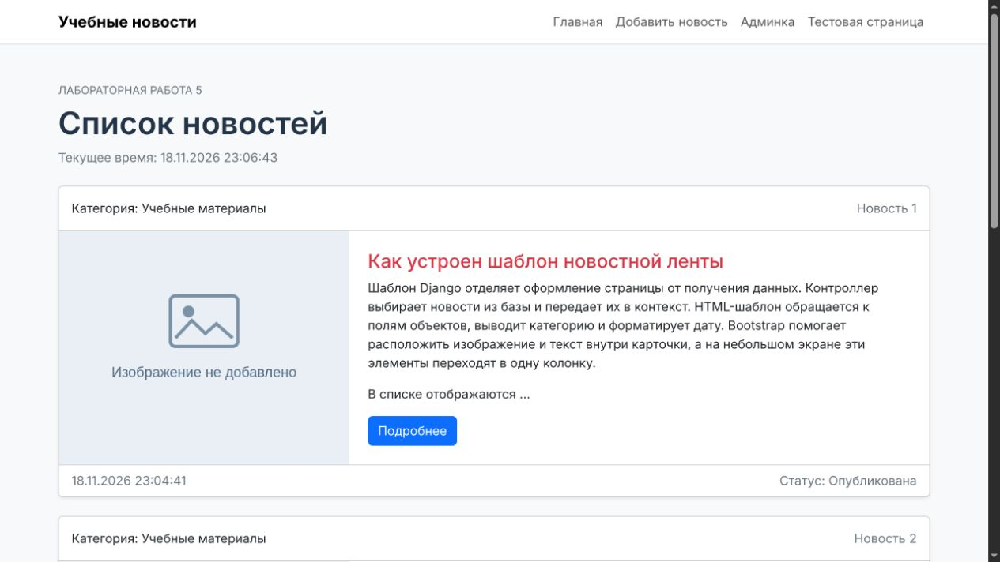
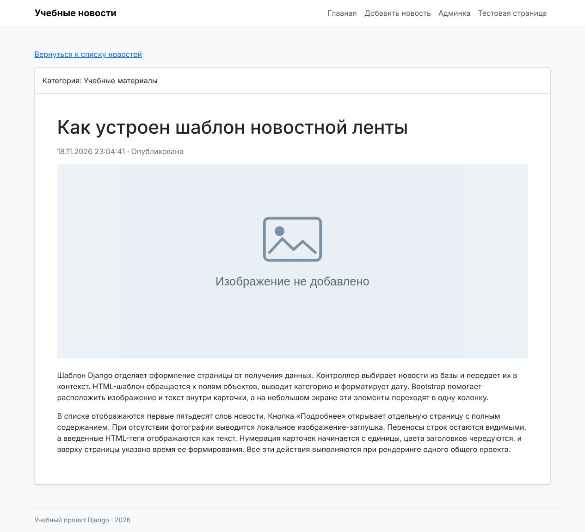
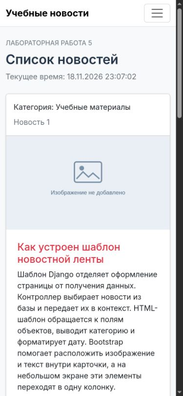
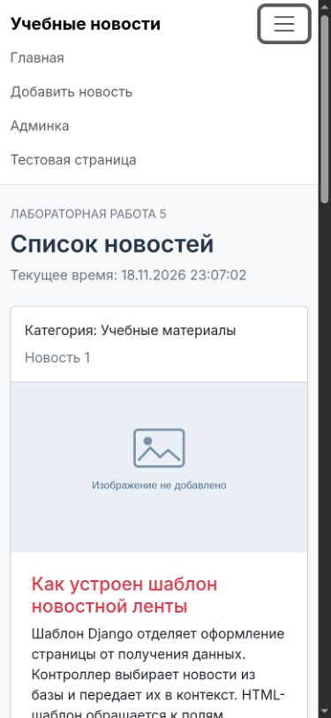

# Отчет по лабораторной работе № 5

МИНИСТЕРСТВО НАУКИ И ВЫСШЕГО ОБРАЗОВАНИЯ<br>
РОССИЙСКОЙ ФЕДЕРАЦИИ<br>
Федеральное государственное автономное<br>
образовательное учреждение высшего образования<br>
«СЕВЕРО-КАВКАЗСКИЙ ФЕДЕРАЛЬНЫЙ УНИВЕРСИТЕТ»<br>
Институт информационных технологий и кибер безопасности<br>
Департамент цифровых, робототехнических систем и электроники<br>
Кафедра программной инженерии

**Дисциплина:** Разработка веб-приложений

**Тема:** Внешний вид шаблона. Директивы. Теги. Фильтры.

**Вариант:** Не предусмотрен методичкой, выполняется вся практическая часть без деления на уровни

**Выполнил:**
Студент группы ПИЖ-б-о-25-2 (2),<br>
направление подготовки: 09.03.04<br>
“Программная инженерия”<br>

Кравцун Михаил Алексеевич

**Проверил:**
Заведующая МИБК<br>
Новикова Елена Николаевна


---

## Репозиторий

[web-app-development](https://github.com/WhXteBeXr/web-app-development), общий код в каталоге `Project/`.

## Цель работы

Улучшить оформление новостного сайта с помощью Bootstrap и применить директивы, теги, фильтры и вызов метода модели в шаблонах Django.

## Постановка задачи

В методичке нет индивидуальных вариантов, уровней и контрольных вопросов. Выполняется вся практическая часть:

1. Подключить Bootstrap через CDN, настроить адаптивную навигацию и контейнер.
2. Оформить новости карточками с категорией, заголовком, текстом, изображением и датой.
3. Добавить ссылки главной страницы и добавления новости.
4. Вызвать метод модели из шаблона.
5. Использовать cycle для чередования цветов, forloop.counter для нумерации и now для текущего времени.
6. Применить форматирование даты, переносов и сокращения текста.
7. Показать фотографию либо изображение-заглушку.
8. Заполнить учебные записи и проверить результат в браузере.

Дополнительно кнопка «Подробнее» открывает реальную страницу полного текста, а не фиктивный адрес.

## Теоретическая часть

Bootstrap предоставляет CSS-компоненты, адаптивную сетку и JavaScript для интерактивных элементов. Подключение через CDN не требует отдельной сборки фронтенда. В проекте используется одна версия Bootstrap 5.3.9 для стилей и скрипта. Атрибут integrity проверяет ожидаемое содержимое ресурса, crossorigin задает режим запроса.

В шаблонах Django переменные выводятся конструкцией `{{ ... }}`, управляющие теги записываются в ``, фильтры применяются через символ `|`. Метод модели без обязательных аргументов может вызываться автоматически при обращении к нему через точку, без скобок.

Цикл for дает объект forloop с текущим счетчиком. Тег cycle последовательно выбирает значения и повторяет их. Тег now формирует текущее время сервера при рендеринге. Фильтр date форматирует дату объекта, linebreaks формирует абзацы и разрывы строк, truncatewords_html ограничивает число слов с сохранением корректных HTML-тегов.

Общий шаблон base.html задает документ, подключения и навигацию. Дочерние шаблоны используют extends и заполняют block content. Тег static формирует адрес локального ресурса, тег url получает адрес по имени маршрута.

## Исходные файлы и реализация

[base.html](../Project/news/templates/news/base.html) содержит общий каркас, Bootstrap CDN, меню и подвал. [index.html](../Project/news/templates/news/index.html) выводит карточки и использует изучаемые конструкции. [detail.html](../Project/news/templates/news/detail.html) отображает полный текст новости.

[site.css](../Project/news/static/news/site.css) задает размеры изображений и перенос длинных строк. [placeholder.svg](../Project/news/static/news/placeholder.svg) - локальная заглушка. Основная сетка и оформление компонентов задаются Bootstrap.

[models.py](../Project/news/models.py) дополнен методом `News.get_publication_status()`. [views.py](../Project/news/views.py) содержит контроллер полной новости, [urls.py](../Project/news/urls.py) задает маршрут `<int:pk>/`. [demo.py](demo.py) создает длинный учебный текст без дублирования при повторном запуске.

Модели связей, ограничения рейтинга и административная панель предыдущих работ сохранены. Изменений схемы данных нет, новые миграции не требуются.

## Практическая часть

### Навигация и карточки

Используются navbar, container, row, col-md-4, col-md-8 и card. На широком экране изображение находится слева, текст справа. На узком экране блоки располагаются друг под другом. Кнопка меню управляется Bootstrap bundle.

Главная ссылка ведет на `/news/`. Ссылка «Добавить новость» ведет на форму Django Admin и сохраняет проверку авторизации. Ссылки формируются по именам маршрутов. Проверочная страница и админка доступны из меню.

Карточка показывает категорию или «Без категории», номер, заголовок, краткий текст, изображение, дату и статус. Заголовки последовательно получают классы text-danger и text-success. Нумерация начинается с 1 и соответствует текущему порядку выборки.

### Метод, теги и фильтры

`get_publication_status()` возвращает «Опубликована» или «Не опубликована». Шаблон вызывает его без скобок. `now` выводит время формирования страницы, `date` форматирует дату создания новости. Это разные значения: одно относится к текущему запросу, другое хранится в модели.

Краткий текст формируется цепочкой default, linebreaks и truncatewords_html:50. Пустой текст получает подпись, переносы сохраняются, вывод сокращается до 50 слов без обрыва HTML-разметки. Автоэкранирование пользовательского содержимого остается включенным.

Фотография берется из `photo.url`. При пустом поле используется SVG из локального каталога static, поэтому для заглушки не нужен внешний сервис изображений.

### Полный текст

Маршрут `/news/<id>/` обрабатывает detail. Объект запрашивается вместе с категорией, отсутствующий идентификатор дает 404. На странице выводится весь текст, дата, категория, статус и изображение. Есть ссылка возврата к ленте.

Как и в предыдущей работе, учебная лента показывает все записи с явным статусом публикации. В этой методичке не задан отдельный отбор только опубликованных записей.

### Учебные данные

Сценарий lab5/demo.py добавляет новость «Как устроен шаблон новостной ленты» из 101 слова. В карточке отображаются первые 50 слов, на отдельной странице доступны оба абзаца полностью. Примеры предыдущих работ показывают короткий текст, неопубликованную запись и фотографию.

## Запуск

Из корня репозитория:

```bash
source .venv/bin/activate
python Project/manage.py migrate
python Project/manage.py shell < lab2/demo.py
python Project/manage.py shell < lab3/demo.py
python Project/manage.py shell < lab4/demo.py
python Project/manage.py shell < lab5/demo.py
python Project/manage.py runserver 127.0.0.1:8002
```

Если прежние данные уже созданы, достаточно lab5/demo.py. Открыть `/news/`, перейти по кнопке «Подробнее», вернуться и проверить меню на узком экране. Для управления записями использовать свою учетную запись администратора. При необходимости создать ее командой `python Project/manage.py createsuperuser`.

Браузеру нужен доступ к CDN для загрузки Bootstrap. Локальные ресурсы news/site.css и news/placeholder.svg обслуживаются Django staticfiles в режиме разработки. Фотографии остаются медиафайлами в `Project/uploads/`.

## Маршруты и ответы

| Запрос | Результат |
| --- | --- |
| GET `/news/` | 200, адаптивная лента карточек |
| GET `/news/<id>/` существующей новости | 200, полный текст |
| GET отсутствующей новости | 404 |
| GET нечислового или отрицательного идентификатора | 404 |
| HEAD списка или полной новости | 200 без тела |
| POST без CSRF-токена | 403 |
| POST с корректным токеном на страницы чтения | 405 |
| GET `/admin/news/news/add/` без входа | 302 на форму входа |
| GET `/news/test/` | 200, прежняя тестовая страница |

## Результаты проверки

Проверено 18 ноября 2026 года. Python 3.14.10, Django 6.1.1, Bootstrap 5.3.9.

| Сценарий | Ожидаемый результат | Фактический результат |
| --- | --- | --- |
| Пустая база | Сообщение вместо карточек, 200 | Подтверждено |
| Три записи | Три карточки в порядке модели | Подтверждено |
| Цикл и счетчик | Номера 1, 2, 3, цвета красный, зеленый, красный | Подтверждено |
| Категория и статус | Реальное название или подстановка, результат метода модели | Подтверждено |
| Длинный текст | В ленте максимум 50 слов, на полной странице весь текст | Подтверждено |
| Короткий и пустой текст | Переносы сохранены, пустота заменена подписью | Подтверждено |
| HTML во входных данных | Теги экранированы на обеих страницах | Подтверждено |
| Фото и заглушка | Корректный URL фотографии либо локальный SVG | Подтверждено |
| now и date | Текущее время запроса и дата записи | Подтверждено |
| Подробнее и возврат | Рабочие именованные адреса | Подтверждено |
| Ошибочные URL и методы | Ожидаемые 404, 403, 405 и HEAD без тела | Подтверждено |
| Запросы к базе | Список и detail с категорией по одному SQL | Подтверждено |
| Прежние связи | CASCADE автора и PROTECT категории работают | Подтверждено |
| Повторный запуск demo.py | Учебная новость не дублируется | Подтверждено |
| Ширина 390 пикселей | Меню раскрывается, горизонтального переполнения нет | Подтверждено в браузере |
| Загрузка оформления | Bootstrap применен, все изображения загружены | Подтверждено в браузере |

Пройдены все 54 программных сценария. При браузерной проверке на ширине 390 пикселей ширина содержимого составила 375 пикселей, меню получило aria-expanded=true, все изображения загрузились. На обычной ширине проверены стили Bootstrap, чередование цветов и переход к полному тексту. В проверке использовался локальный порт 8015 и временная база без изменения рабочих учетных записей.

Материалы: [scenarios.json](media/scenarios.json), [browser-checks.json](media/browser-checks.json), [demo-output.txt](media/demo-output.txt), [environment.txt](media/environment.txt).



Рисунок 1 - карточки Bootstrap, категория, номер, сокращенный текст, дата и статус.



Рисунок 2 - отдельная страница с полным содержанием.



Рисунок 3 - изображение и текст расположены вертикально при ширине 390 пикселей.



Рисунок 4 - навигация Bootstrap на мобильной ширине.

## Вывод

Новостная лента оформлена адаптивными компонентами Bootstrap. Применены переменные, наследование шаблонов, цикл, условия, нумерация, cycle, now, форматирование дат и сокращение текста. Метод модели вызывается из шаблона, фотографии имеют локальную замену, кнопка «Подробнее» открывает полный текст. Работоспособность подтверждена 54 сценариями и проверкой обычного и мобильного отображения в браузере. Общий проект сохраняет модели, связи и админку предыдущих лабораторных.
